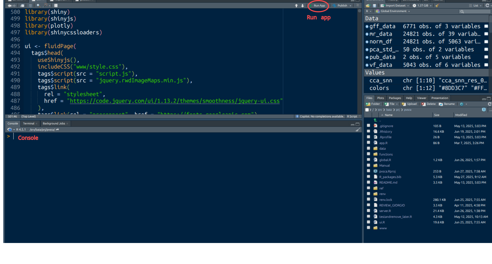

# Introduction

**PlaViSca** is a free, open-source, interactive R Shiny application designed for the analysis and visualization of single-cell RNA sequencing (scRNA-seq) data from *Plasmodium vivax*. It empowers researchers, especially those in the malaria research community, to explore and interpret complex datasets through an intuitive, code-free interface.

**Key features**:
- **Metadata** – Browse, filter, and export metadata interactively, enabling selection by study, sample type, parasite stage, or other variables.
- **Quality Control** – Assess data quality through violin plots and filter cells based on metrics across studies.
- **Data Sources** – Access information and references for all integrated datasets.
- **Gene Expression** – Visualize stage- or gene-specific expression patterns, dynamically add or remove plots, and compare multiple genes in real time.
- **Embeddings** – Explore cells in 2D or 3D using PCA, UMAP, or t-SNE, for both integrated and unintegrated datasets. Cells can be selected to reveal expression profiles in downloadable tables.

# Hosting and access

PlaViSca is hosted online, providing users with direct access to the web application via the following website: [PlaViSca Web Application](https://xxxx.com). This platform serves as the central hub for exploring and analyzing scRNA-seq of *Plasmodium vivax* data without requiring local installation.

For users who prefer to run the application on their local computer, the following steps provide detailed guidance on setting up PlaViSca locally.

# Local installation

PlaViSca is compatible with macOS, Windows, and Linux operating systems. Follow the steps below to set up the application on your system

## Requirements

- **R**: Version 4.5 or later ([Download R](https://cran.r-project.org/))
- **RStudio**: Version 2025 or later ([Download RStudio](https://posit.co/download/rstudio-desktop/))
- **Git**: Version 2.43 or later ([Download Git](https://git-scm.com/downloads))
- **Recommended RAM**: at least 16GB
- **CPU**: at least 4 cores
- **Disk**: at least 5GB free space

## Getting source code from the repository

```bash
git clone https://github.com/Sopheap15/pvsca.git
```

Struture of the project directory:
```
.
├── app.R              # Sources ui.R and server.R
├── data/              # Store input datasets
├── functions/         # Custom functions and preprocessing scripts
├── global.R           # Loads data and functions into the global environment
├── pvsca.Rproj        # RStudio project file
├── README.md          # Project overview and installation instructions
├── manual.R           # User manual for effective using PlaViSca web application
├── ref/               # Reference data directory such as genome annotation
├── server.R           # Shiny server logic
├── ui.R               # Shiny user interface definition
└── www/               # Static assets (images, CSS, JavaScript)
```
After cloning the repository, open the `PlaViSca` directory or navigate to it using the terminal by running `cd PlaViSca`.

## Gene expression data and metadata

PlaViSca requires gene expression data and metadata files. These files can be downloaded from XXX. Ensure that the data is formatted correctly and adheres to the application's requirements.

### Preparing data
1. Place the files in the `data/` directory within the project folder.
2. Ensure the gene expression data is in `.rds` format and save in three files normliazed_df.rds, scale_df.rds, cleaned_dataset.rds
3. Metadata should be provided in a compatible format (e.g., `.csv` or `.rds`).

**metadata columns**:
- nCount_RNA: Total number of RNA molecules (UMI counts) detected per cell.
- nFeature_RNA: Number of unique genes detected per cell.
- study_pmid: PubMed ID of the publication associated with the dataset.
- study_label: Short identifier for the study (e.g., Hazzard2022).
- run_id: Identifier of the sequencing run/sample (e.g., SRR11008272).
- num_srr: Number of sequencing runs (SRA accessions) per sample (e.g., 10 run for Sa2022).
- pub_year: Year of publication (e.g., Ruberto2022_1 published in 2022).
- geographic_location: Location where the study was performed (e.g., Modulkiri Cambodia).
- sc_technology: Single-cell technology used (e.g., 10x Genomics Chromium v3).
- sequencer: Sequencing platform (e.g., Illumina NovaSeq 6000).
- host_species: Host species from which the sample was derived (e.g., Anopheles stephensi, Saimiri boliviensis).
- host_id: Identifier for the individual host organism (Saimiri boliviensis 3879).
- sample_type: Type of biological material collected (e.g., vector salivary gland, host blood).
- parasite_stage: Parasite lifecycle stage represented in the sample (e.g., blood stage).
- strain: Parasite strain or isolate (e.g., Sal1, Sal1/Chesson).
- day_post_infection: Number of days after infection when the sample was collected.
- life_cycle_stage: Annotated lifecycle stage of the parasite (e.g., ring, trophozoite, schizont, gametocyte).
- treatment: Experimental treatment applied to the sample (e.g., drug, control; NA if none).
- biological_replicate: Replicate number for independent biological samples.
- barcode: Unique single-cell barcode identifier from the sequencing library.
- RNA_snn_res.0.01 … RNA_snn_res.0.1: Clustering assignments from Seurat at multiple resolution parameters (0.01–0.1). Each column corresponds to one resolution setting.
- hour_post_invasion: Number of hours after parasite invasion of host cells, derived from SingleR prediction.

There are also columns that were retained in the Seurat object but not used in the analysis, including:
- liver_form: Metadata carried over from the study, indicating whether a cell was annotated as a liver-stage parasite.
- pred_gametocyte: Predicted annotation of whether the cell is a gametocyte, based on a module score–based gametocyte prediction.
- seurat_clusters: Clustering solution generated by Seurat prior to assigning module score–based identities.

Once the data is in place, open the `pvsca.Rproj` file. This action will launch RStudio and automatically set the working directory to the appropriate project folder, preparing the environment for running the application.


## Install dependencies
PlaViSca requires several R packages to be installed. We can install the required dependencies in Rstudio console: `install.packages(c("shiny", "shinyjs", "shinycssloaders", "plotly", "DT", "RColorBrewer", "tidyverse", "later"))`. or in stall the specific version of packages using the following code:

```r
install.packages("remote")

remote::install_version("shiny", version = "1.10.0")
remote::install_version("shinyjs", version = "2.1.10")
remote::install_version("shinycssloaders", version = "1.1.0")
remote::install_version("plotly", version = "4.10.4")
remote::install_version("DT", version = "0.33")
remote::install_version("RColorBrewer", version = "1.1.3")
remote::install_version("tidyverse", version = "2.0.0")
remote::install_version("later", version = "1.4.2")
```

# Run Application

**Figure 1:** Rstudio

## Option A: from RStudio
- Open either `app.R` or `server.R` or `ui.R`
- Click the **Run App** button in the top-right of the Rstudio see in **Figure 1**.

## Option B: terminal for GUI computer
Navigate to the project directory and run the following command in your terminal:
```bash
R -e "shiny::runApp('.', launch.browser = TRUE)"
```
## Option C: terminal for computer without GUI like server
Navigate to the project directory and run the following command in your terminal:
```bash
R -e "shiny::runApp('.', host='0.0.0.0', port=3838)"
```
Open your browser with `http://server_ip:3838`. 
You can find your server ip with `ip addr show | inet`
