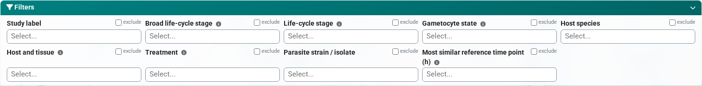
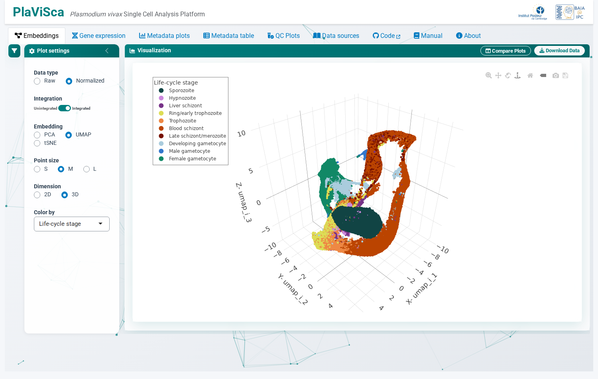
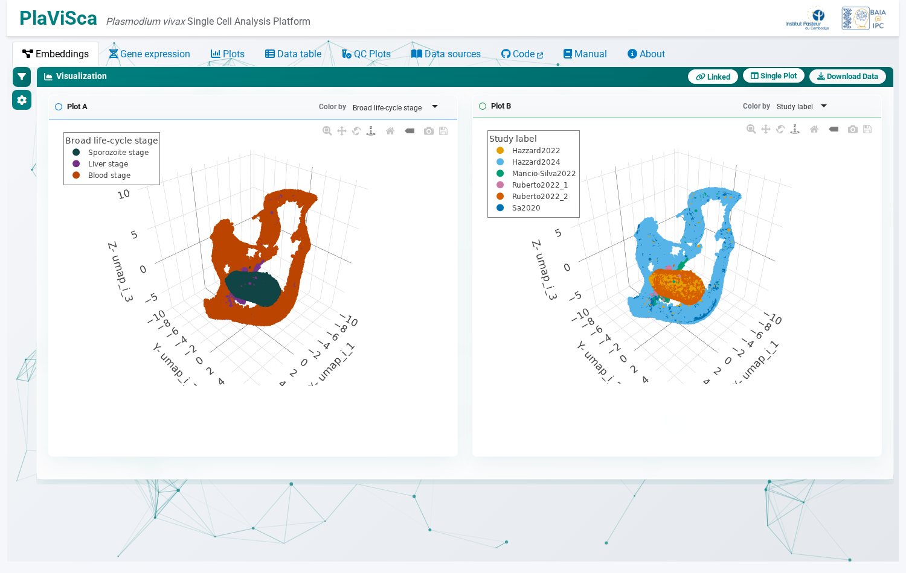
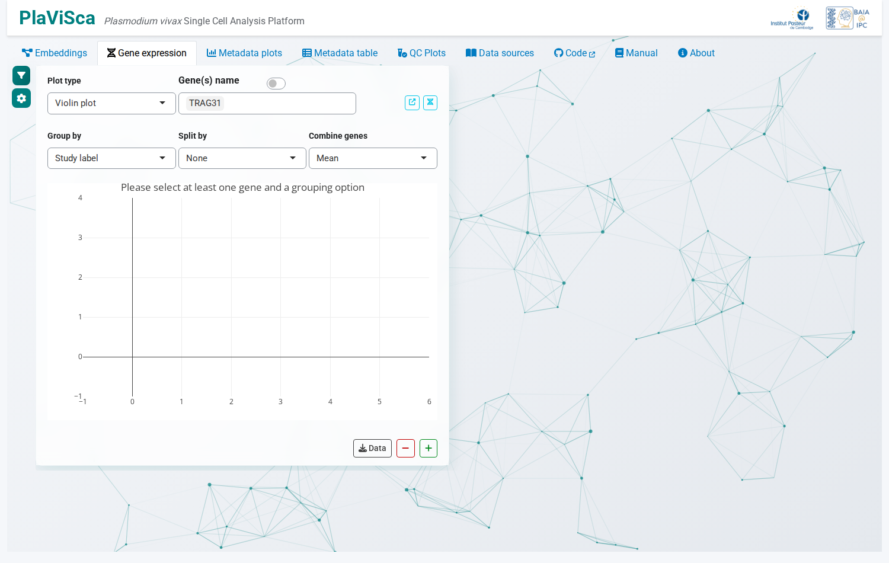
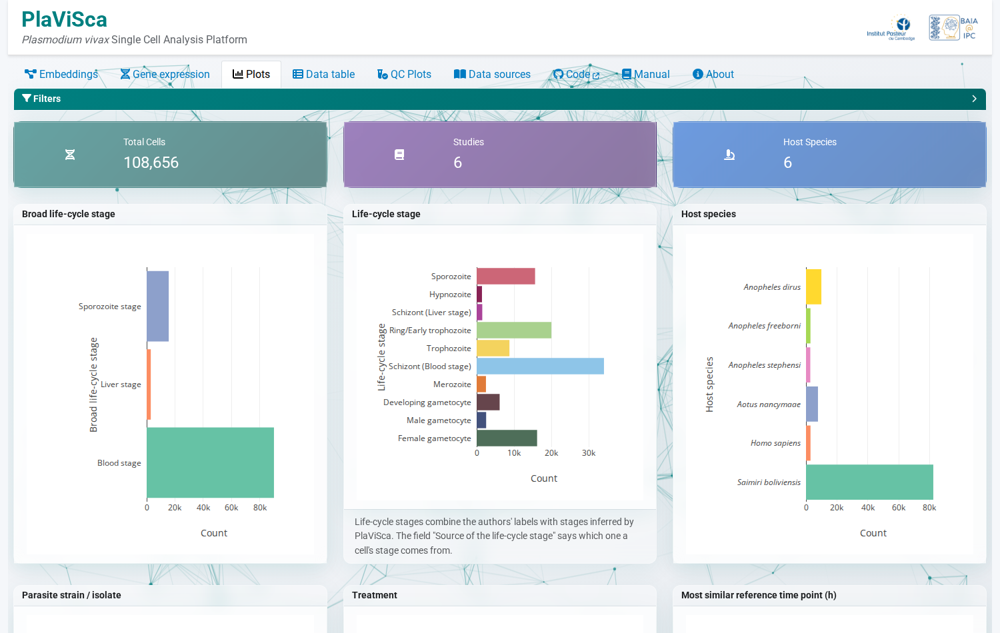
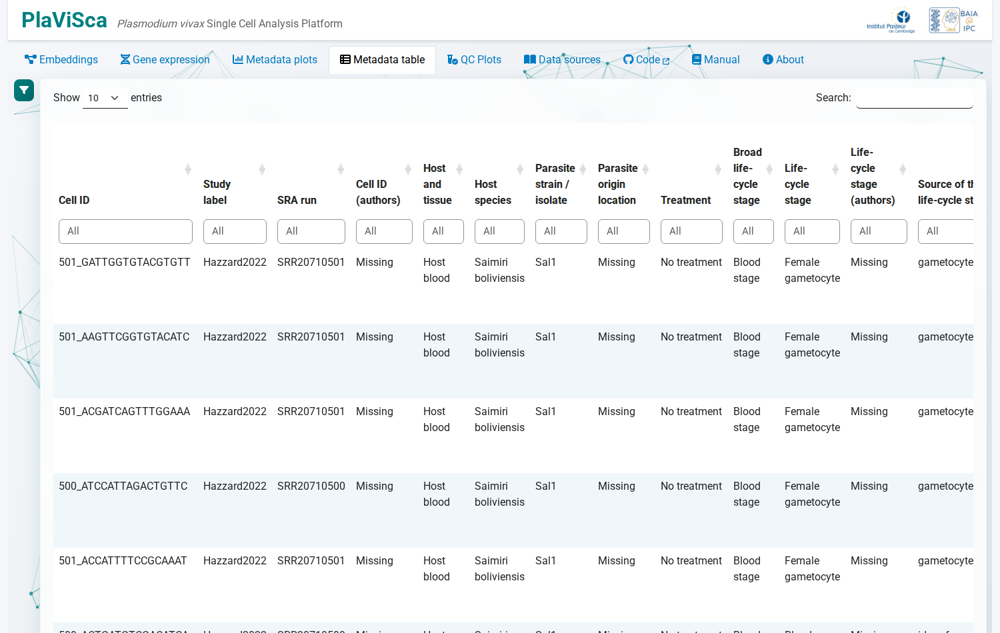
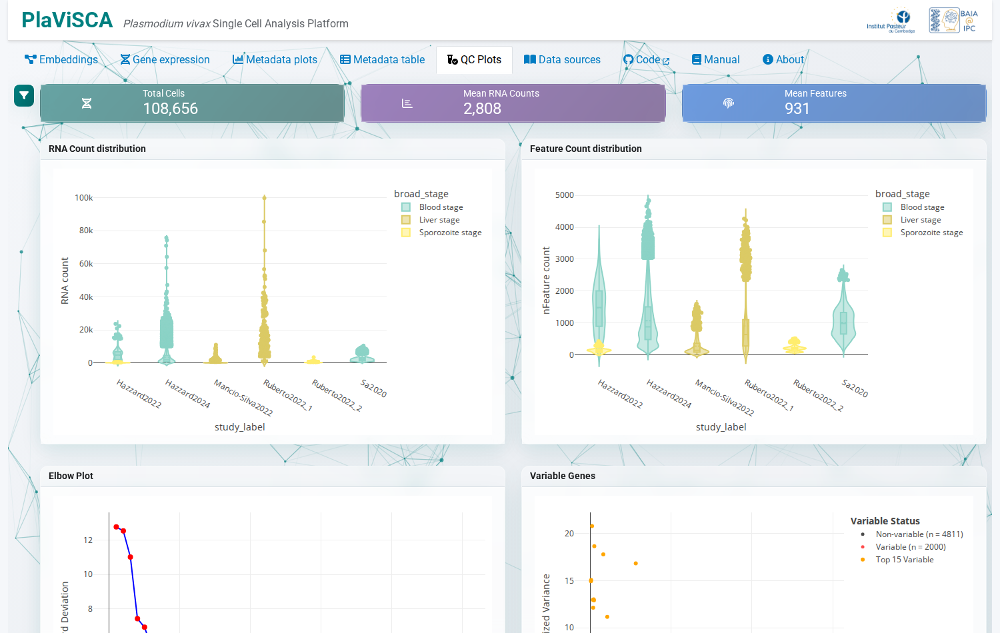
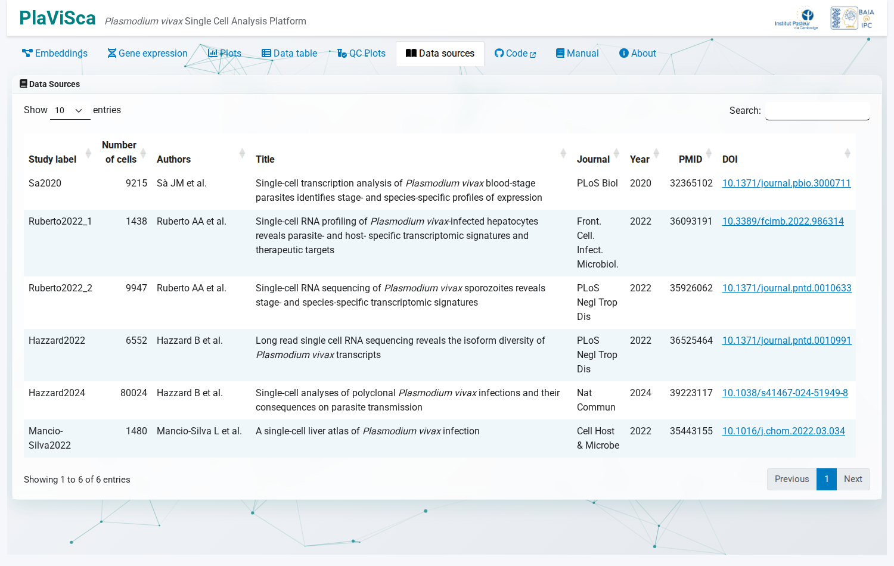

# User Manual

Welcome to PlaViSCA, an interactive web application for exploring single-cell RNA-seq data from _Plasmodium vivax_. This manual provides comprehensive guidance on navigating and utilizing the application's features for malaria research.

**Quick Start:**
1. Open the **Filters** box on any tab to focus on relevant samples
2. Explore expression patterns and quality metrics via interactive visualizations
3. Compare multiple genes in the **Gene Expression** tab
4. Download plots and data for external analysis

**Data Integration**: PlaViSCA brings together about 106,000 cells from six published studies, processed with one preprocessing pipeline. See the Data Processing Pipeline section for details.

## Overview of PlaViSCA Features

PlaViSCA is a single page: a top bar with the application name and the Institut Pasteur du Cambodge (IPC) and BAIA logos, and below it a row of tabs, each focusing on one aspect of the data:

- **Embeddings**
- **Gene Expression**
- **Metadata plots**: charts of the cell metadata
- **Metadata table**: one row per cell with its metadata
- **QC Plots**
- **Data Sources**
- **Code**: opens the source code of the app on GitHub, in a new browser tab
- **Manual**: this manual
- **About**: the project, its team and how to get involved

The app opens on the Embeddings tab, over an animated particle background.

All data tabs (Embeddings, Gene Expression, Metadata plots, Metadata table, QC Plots) share a common **Filters** row at the top with the following fields:

| Filter field | Description |
|---|---|
| Study label | Study the cell comes from |
| Broad life-cycle stage | Blood, liver or sporozoite stage |
| Life-cycle stage | Detailed stage (e.g. Ring/Early trophozoite, Trophozoite, Hypnozoite, Female gametocyte); only stages compatible with the selected broad stage are offered |
| Host species | Host organism |
| Host and tissue | Host blood, host liver or vector salivary gland |
| Treatment | Drug treatment; "Study control" is the control arm of a drug experiment, "No treatment" means the study had no drug arm |
| Parasite strain / isolate | Parasite strain or clinical isolate |
| Most similar reference time point (h) | For blood-stage cells: the time point of a reference blood-stage time course (Zhu et al. 2016) whose expression is most similar to the cell. It is a similarity, not a measured time |

Hover over the help icon next to a filter for its full description. Cells with a missing value are shown as "Missing"; for the gametocyte state, cells that are not gametocytes are shown as "No gametocyte".

Filters apply with **OR logic within each field** and **AND logic between fields**, allowing precise subsetting of the dataset. All tabs stay synchronized with each other's filter selections.

To leave out some values instead of keeping them, tick **exclude** next to the name of the filter: the selected values are then shown struck through in red, and the cells with them are left out. For example, to show all studies but one, tick **exclude** next to "Study label" and select that study.

The **Filters** start folded, as a button with a funnel at the top left of the tab (above the cog of the plot settings). Click it to unfold the Filters above the plots, and click their title bar to fold them again. The number of filters set is shown on the button, or in the title, e.g. **Filters (2)**. Folding is shared by all tabs: folding the Filters on one tab folds them on every tab.

**Figure 1**: the Filters box, unfolded

### Embeddings

**Figure 2**: Embeddings tab, with the plot settings open and cells colored by life-cycle stage

**Figure 3**: Compare Plots mode: the same embedding colored by broad life-cycle stage and by study

The Embeddings tab offers dimensionality reduction and customizable visualization of single-cell data (**Figures 2 and 3**). Key capabilities:

**Plot Settings:** the settings sit in a panel left of the plot, folded by default: click the cog button to open it, and the arrow at its edge to fold it again. The Gene expression tab has the same panel, and the panel is open or folded on both tabs at once.

| Setting      | Options                                        |
|--------------|------------------------------------------------|
| Data Type    | Raw, Normalized (default: Normalized)          |
| Integration  | Integrated / Unintegrated (not available for t-SNE) |
| Embedding    | PCA, UMAP (default), t-SNE                     |
| Point Size   | S / M (default) / L                            |
| Legend Position | Auto (default), Top left, Top right, Bottom left, Bottom right, Right, Below, Hidden |
| Legend Size  | S / M (default) / L                            |
| Dimension    | 2D / 3D (default)                              |
| X / Y axes   | Selectable when 2D mode is active              |

**Legend position and size**: the legend (the colors of a category, the color scale of gene expression, or the color key of *Each gene separately*) goes over a corner of the plot, right of it or below it, or is hidden. *Auto* puts it over the top-left corner, or below the plots in 2D Compare Plots mode; the color grid of 2 genes and the color wheel of 4 or more genes go right of the plot. Outside the plot, the legend takes room from the plot. **Legend Size** makes its text and color scale smaller or larger, e.g. for a screenshot.

**Color by** (in the title bar of the plot): **Genes ▸** (first in the menu), Study label, Broad life-cycle stage, Life-cycle stage, Host species, Host and tissue, Treatment, Parasite strain / isolate, Parasite origin location, or Single-cell technology (default: Life-cycle stage). With Genes, a row with the gene menu (and, for several genes, **Combine genes**) appears above the plot, under its title bar.

**Coloring by genes**: with **Color by** set to *Genes*, select up to 10 genes by name, or by ID with the switch next to the menu (switching keeps the selected genes). With one gene selected, the buttons at the end of the row open its PlasmoDB and NCBI pages. With more than one gene, **Combine genes** sets how they color the cells:

| Combine genes | Color of a cell |
|---|---|
| *Mean* (default for more than 8 genes) | the mean expression of the genes, on one color scale |
| *Sum* | the sum of their expression |
| *Each gene separately* (2 to 8 genes; default) | each gene has its own color, and the color of a cell mixes the colors of the genes it expresses (see below) |

With *Each gene separately*, the expression of each gene is scaled to 0–1 within the cells shown, with full color at its 99th percentile, and the cells with the highest expression are drawn on top. The hover text gives the expression of each gene. How the colors mix depends on the number of genes.

*2 or 3 genes*: light grey where no gene is expressed, red for the first gene, green for the second, blue for the third. Co-expression gives mixed colors: red + green = yellow, red + blue = magenta, green + blue = cyan, all three = dark grey. For 2 genes, a color grid (by default right of the plot) shows the color of each combination of the two expression values; for 3 genes, the legend lists the color of each gene and of their combinations. Example: select CSP and AMA1 (*Each gene separately* is chosen by default), to see the cells expressing CSP (red), AMA1 (green) or both (yellow).

*4 to 8 genes*: the genes get evenly spaced colors around a color wheel, in the order in which they were selected: the first gene is red and is at the top of the wheel, the others follow clockwise. The wheel, by default right of the plot, shows each gene at its color around a color disc: the disc gives the color of a strongly expressing cell from the mix of its genes, with mixed colors between neighboring genes and grey in the center, where genes in balance cancel out. To read the color of a cell:

- **hue**: which genes the cell expresses. A cell expressing one gene has that gene's color; a cell expressing two neighboring genes on the wheel has a color between theirs.
- **saturation**: how specific the cell is. One gene gives a strong color; several genes mix toward grey.
- **darkness**: the total expression of the cell: the sum of its scaled genes, with full darkness at the 99th percentile of this sum among the cells shown. It goes from light grey (no expression) to a dark, strong color, so a cell expressing several genes is darker than a cell expressing one of them at the same level.

The hover text also gives the gene with the largest share of the cell's expression (e.g. *Dominant: CSP (72%)*). Genes opposite each other on the wheel cancel out: a cell expressing both equally is grey, as is a cell expressing all genes equally. Select genes that you expect in the same cells one after the other, so that they get neighboring colors. With many genes, neighboring colors are hard to tell apart: from about 6 genes, check the hover text, or use *Mean* or *Sum*.

**Visualization bar**: the title bar of the plot holds **Color by** and the **Compare Plots** and **Download Data** buttons.

**Compare Plots mode**: Click **Compare Plots** to display two independent plots (Plot A and Plot B) side-by-side, each with its own **Color by** selector in its title bar; a plot colored by genes has its own gene row between its title bar and the plot, and the two plots stay aligned. In 2D, the legends sit below the plots by default, so that they do not cover cells; the two plots share the plot settings, including the legend position and size.

**Interactive Cell Selection**: Click any cell to open a modal dialog showing a per-cell gene expression table (gene ID, gene name, expression value, description). The table is filterable and exportable as CSV.

**Download Data**: Exports the currently filtered metadata as a CSV file.

### Gene Expression

**Figure 4**: Gene expression tab

The Gene Expression tab provides an interactive interface for exploring gene expression across various biological conditions (**Figure 4**). Key features:

- **Flexible Plot Management**: Add or remove plot panels dynamically (panels display in a 2-column layout). Each panel has its own plot type, gene selection and grouping.
- **Data Type**: Choose Raw or Normalized expression data (Scaled data is currently disabled).
- **Gene Search**: Toggle between Gene Name and Gene ID search using the switch in each panel. The selected genes are kept: they switch to the other identifier, and genes without a name keep their ID.
- **Gene Selection**: Select up to 10 genes per panel.
- **Group by**: Organize expression by Study label, Broad life-cycle stage, Life-cycle stage, Host species, or Treatment.
- **Plot type**: the first menu of each panel; the options below it depend on the plot type:

  | Plot type | What it shows | Options |
  |---|---|---|
  | Violin plot, Box plot | the expression of each cell, per group | **Split by**: a second field, drawn side by side in its colours; **Combine genes**: with several genes, their *Mean* or *Sum* in each cell, or *Each gene separately* (one row per gene) |
  | Cleveland dot plot | one point per group and gene, one row per gene | **Value**; **Points by**: one point per value of a second field (Study label by default), side by side |
  | Dot plot (Seurat style) | genes × groups: the dot size is the % of cells detecting the gene, the colour the mean expression | **Scale per gene** |
  | Heatmap | genes × groups, coloured by the chosen value | **Value**; **Scale per gene** |

  **Value** is one of *% detecting* (the % of cells with expression above 0), *Mean expression* (of all cells of the group) or *Mean where detected* (of the cells with expression above 0). **Scale per gene** shows, for each gene, how far a group is from the gene's mean across the groups, in standard deviations, so that genes with different expression levels share one colour scale. On normalized data, the mean of several genes is the log of their geometric mean (+1).

  In the dot plots and the heatmap, groups with fewer cells than **Min. cells per group** (in the settings panel, 20 by default) and cells with a missing value are left out.

  Example: select DBP, CSP and AMA1, choose the Cleveland dot plot and group by Life-cycle stage, to see whether each study detects the genes in the same stages.
- **Annotations**: with one gene selected, buttons next to the gene menu open its PlasmoDB and NCBI pages (hidden while several genes are selected).
- **Download**: Export per-panel expression data as an `.xlsx` file containing an Expression Data sheet and a Metadata sheet.

### Metadata plots

**Figure 5**: Metadata plots tab

The Metadata plots tab counts the selected cells by one or two metadata fields and draws the counts as the plot you choose (**Figure 5**). Changing the filters updates the value boxes and the plots.

**Summary value boxes:**

| Box           | Description                            |
|---------------|----------------------------------------|
| Total Cells   | Number of cells after filtering        |
| Studies       | Number of distinct studies represented |
| Host Species  | Number of distinct host species        |

**Plots.** Each plot sits in a panel taking half the width of the page. Choose the plot type first; it decides whether the cells are counted by one field or by two:

| Control | What it does |
|---|---|
| **Plot type** | for one field: bar chart or pie chart. For two fields: stacked bars, grouped bars, heatmap, sunburst, or one pie per group (up to 12 groups) |
| **Count by** | the field to count the cells by, e.g. Study label or Life-cycle stage |
| **Split by** | only for the plot types of two fields: the second field, which splits each group of cells, e.g. the life-cycle stages within each study |
| **Cells / % of cells** | below the plot: numbers of cells, or percentages. With one field, a percentage is the share of all selected cells; with two fields, the share of the cells with the same value of the first field (each bar of a stacked bar chart then adds up to 100%) |

The two-field plot types show the same counts in different ways:

- **Stacked bars**: one bar per value of the first field, divided by the second field. Shown as percentages, they compare compositions, e.g. of studies of different sizes.
- **Grouped bars**: the same pieces side by side, for comparing their sizes.
- **Heatmap**: a table of all pairs of values, with the number or percentage written in each cell; empty cells have no cells of that pair. Readable also when both fields have many values.
- **Sunburst**: the first field in the inner ring, the second in the outer ring. Click a sector to zoom into it, and the centre to zoom out.
- **One pie per group**: one pie for each value of the first field.

Below the plot are the descriptions of the chosen fields and **Export .csv**, which saves the counts shown in the plot as a table.

**More plots.** Click **+** below the last plot to add another one next to it (two per row), and **−** to remove a plot. Each plot has its own controls; all of them use the same filters.

*Example: compare the life-cycle stages of the studies.* Choose **Plot type** "Stacked bars", **Count by** "Study label", **Split by** "Life-cycle stage" and "% of cells". Each bar is one study, divided into its stages. Click **+** and choose "Heatmap" with the same fields in the new plot to read the exact percentages next to it.

> **Note:** Blood-stage cells get the life-cycle stage inferred by PlaViSCA: the gametocyte call of the cell's cluster, otherwise the most similar reference time point. Sporozoites and liver stages, which PlaViSCA does not classify, keep the authors' labels. The field "Source of the life-cycle stage" says which one a cell's stage comes from. The authors' labels remain available for comparison ("Life-cycle stage (authors)", "Gametocyte sex (authors)"): split one by the other to compare them.

The settings panel (cog button) has one option, **Show missing**: untick it to leave out of all plots the cells whose value is missing.

Hover over the plot for details; use the controls in its top-right corner to zoom, pan or download it (as PNG or SVG).

### Metadata table

**Figure 6**: Metadata table tab

One row per cell: the cell ID, study, SRA run and the authors' cell ID (missing for Hazzard2022, whose cells were called by PlaViSCA), then the host and tissue, strain and origin, treatment, life-cycle stage (and the authors' stage), reference time point, gametocyte calls, biological replicate, day post infection, technology, sequencer and counts. Search globally or filter by column, and export the table as CSV.

### QC Plots

**Figure 7**: QC Plots tab

The QC Plots tab provides visualizations to assess the integrity of single-cell RNA sequencing data (**Figure 7**).

**Summary value boxes:**

| Box               | Description                              |
|-------------------|------------------------------------------|
| Total Cells       | Number of cells after filtering          |
| Mean RNA Counts   | Mean number of RNA counts per cell       |
| Mean Features     | Mean number of features (genes) per cell |

**Plots:**

- **RNA Count distribution**: Violin plot of RNA counts per cell, per study, coloured by broad life-cycle stage.
- **Feature Count distribution**: Violin plot of feature (gene) counts per cell, per study, coloured by broad life-cycle stage.
- **Elbow Plot**: PCA standard deviation per component — used to determine the optimal number of PCs.
- **Variable Genes**: Mean expression vs. standardized variance scatter plot, highlighting the top 15 highly variable features (HVF).

The Elbow and Variable Genes plots show one study: the first one the Study filter selects, or the first study of the atlas when no study is selected.

All plots respect the shared metadata filters and support interactive zooming, panning, and download via the Plotly toolbar.

### Data Sources

**Figure 8**: Data sources tab

The Data Sources section provides detailed documentation and attribution for the datasets utilized within PlaViSCA (**Figure 8**). It lists each study with its number of cells, authors, title, journal, year, PubMed ID and DOI link, enabling users to directly access the original publications. This ensures transparency, facilitates reproducibility, and appropriately credits the contributors of the datasets.

#### Data Processing Pipeline

All six studies are processed by the [PlaViSCA preprocessing pipeline](https://github.com/baia-ipc/PlaViSCA-meta-analysis): from the sequencing reads (STARsolo count matrices) or the authors' count matrices, through cell calling, normalisation, integration (Harmony), embeddings and life-cycle stage annotation, to the data files read by the app. Expression is available as raw counts and log-normalised values.

To set up the app with these files, see the [Setup Guide](setup_guide.md).

### About

The **About** tab describes what PlaViSCA contains and how the data were processed, links to the source code of the app and of the analysis pipeline, and gives the citation of the PlaViSCA study and the contact person.

## Best Practices

- **Filter First**: Start by setting the Filters to focus on relevant data.
- **Leverage Interactivity**: Hover for tooltips, download plots, and export data for external tools.
- **Quality Check**: Verify data reliability in the QC Plots tab before drawing conclusions.
- **Compare Systematically**: Add multiple Gene Expression plots side-by-side for cross-condition comparison.
- **Document Findings**: Download all plots and data for reproducibility.

## Contact

- **Giorgio Gonnella**, Head of Bioinformatics and AI Applications, Institut Pasteur du Cambodge ([ggonnella@pasteur-kh.org](mailto:ggonnella@pasteur-kh.org)), for questions related to the implementation of the software, its features, the meta-analysis and the integration of new datasets.
- **Anthony Ruberto**, Assistant Professor, Department of Biomedical Sciences, College of Medicine, Florida State University ([anthony.ruberto@med.fsu.edu](mailto:anthony.ruberto@med.fsu.edu)), for questions related to the meta-analysis, his datasets included in this work in particular, or general questions related to single-cell transcriptomics of _P. vivax_ parasites.

Bug reports and suggestions can also be filed as an issue on [GitHub](https://github.com/baia-ipc/PlaViSCA-app/issues).

PlaViSCA is a research tool for exploring published data; verify results independently before drawing conclusions.
