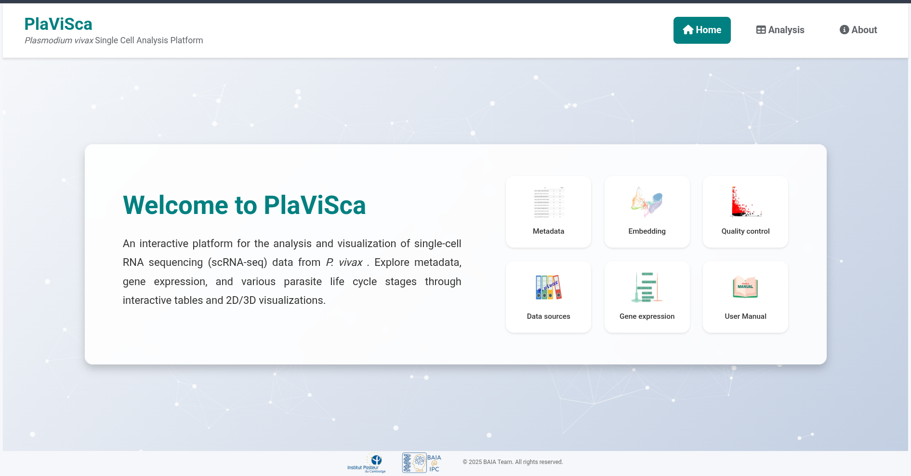
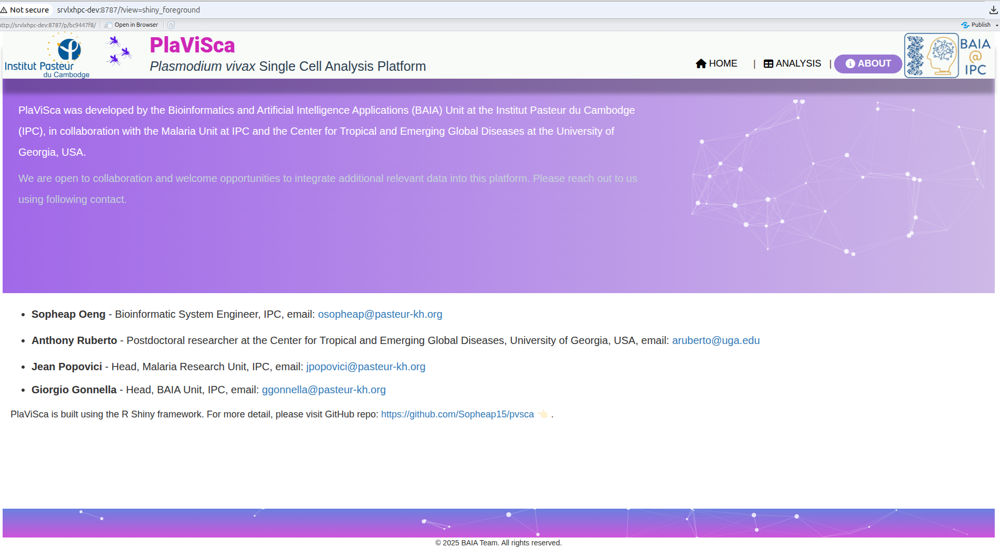

# User Manual

Welcome to PlaViSca, an interactive web application for exploring single-cell RNA-seq data from _Plasmodium vivax_. This manual provides comprehensive guidance on navigating and utilizing the application's features for malaria research.

**Quick Start:**
1. Filter data using the **Metadata** tab to focus on relevant samples
2. Explore expression patterns and quality metrics via interactive visualizations
3. Compare multiple genes in the **Gene Expression** tab
4. Download plots and data for external analysis

**Data Integration**: PlaViSca processes data from five studies using standardized Nextflow pipelines. See the Data Processing Pipeline section for technical details.

## Overview of PlaViSca Features

PlaViSca consists of three main sections: **Home page**, **Analysis page**, and **About page**. Each section is designed to offer an intuitive, code-free platform for exploring single-cell RNA-seq data from _Plasmodium vivax_.

## Home page

**Figure 2**: PlaViSca home page

The Home page acts as the central landing point for users see **Figure 2**. It provides a concise overview of the application's purpose and offers direct access to its core functionalities.

**Menu bar**:

The menu bar provides consistent branding and navigation across the entire application. It is fixed at the top of the interface, ensuring it remains visible and accessible on all pages for easy navigation.

- Left side: Displays the Institut Pasteur logo, representing the institution supporting the project.
- Center: Shows the application name, PlaViSca, prominently, accompanied by a small animated mosquito icon that symbolizes the _Plasmodium vivax_ vector.
- Right side: Contains the main menu items, including Home, Analysis, and About, which allow users to navigate between different pages of the application. At the very end right of the bar, there are also feature icons representing the development and hosting units — Bioinformatics and Artificial Intelligence.

**Content**:

- The left section of the Home page contains a brief text outlining the goals and motivation behind the development of PlaViSca. It introduces the app as an interactive, code-free platform for exploring single-cell RNA-seq data from _P. vivax_, targeting researchers and public health professionals.
- The right section displays a grid of interactive icons, each linking to a specific part of the application. These icons act as shortcuts, enabling users to quickly access key modules:

- **Metadata**: Explore and filter dataset metadata.
- **Analysis**: Access the main analysis tabs (Embeddings, Quality Control, etc.).
- **Quality Control**: Assess data quality metrics.
- **Data Source**: View dataset references and sources.
- **Gene Expression**: Visualize gene expression patterns.
- **Contribution**: Learn how to contribute to the project.
- **User Manual**: Access this documentation.
- **Source Code**: View the GitHub repository.
- **About**: Information about the project and team.

Detailed explanations of these modules' functionalities are provided in the following sections.

**Footer**:

The footer features a mosquito animation alongside interactive particle effects, enhancing the visual appeal of the website and making the interface more dynamic and engaging. Additionally, the footer includes a copyright notice: © 2025 BAIA Team. All rights reserved. This acknowledges the work of the development team and reserves the rights to the content and design.

## Analysis page

The Analysis page is designed to facilitate interactive exploration of both metadata and gene expression data. The page is organized into five tabs, each focusing on a distinct aspect of data analysis:

### Metadata

<iframe width="100%" height="360" src="https://www.youtube.com/embed/znUUFwZDzY0" frameborder="0" allow="accelerometer; autoplay; clipboard-write; encrypted-media; gyroscope; picture-in-picture" allowfullscreen></iframe>

**Video 1:** Metadata filtration

A short video demonstration of the Metadata tab **Video 1**. This video provides an overview of how to filter datasets by biological and experimental attributes, such as host species, life cycle stage, treatment, parasite stage, and sample type. Applying filters dynamically updates both plots and tables, enabling users to focus on relevant data subsets for further analysis.

**Interactive Features:**
- **Plotly Charts**: Hover for details. Use controls (zoom, pan, download) in the top-right corner.
- **DT Table**: Search globally or filter by column. Export as CSV.

### Quality Control

**Figure 3**: Quality control image

The Quality Control tab provides visualizations to assess the integrity of single-cell RNA sequencing data **Figure 3**, including:

- RNA Count vs. Sample
- nFeature Count vs. Sample
- Standard Deviation Plot of PCA
- Standard Variation vs. Mean Expression Plot

All plots support interactive filtering, enabling targeted quality assessment based on user-defined thresholds.

### Data source

**Figure 4**: Data source

The Data Source section provides detailed documentation and attribution for the datasets utilized within PlaViSca **Figure 4**. It includes comprehensive metadata such as journal names, publication dates, article titles, authors, and DOI links, enabling users to directly access the original publications. This ensures transparency, facilitates reproducibility, and appropriately credits the contributors of the datasets.

#### Data Processing Pipeline

PlaViSca integrates data from five studies processed using Nextflow pipelines for downloading, alignment, and feature counting.

- **Download FASTQ Files**: Scripts in the [download_SRA GitHub repo](https://github.com/Sopheap15/download_SRA) download data from NCBI. Follow the `README.md` for instructions.
- **Alignment and Feature Count**: Processed using STARsolo via Nextflow in the [sRNA_nextflow_starsolo GitHub repo](https://github.com/Sopheap15/sRNA_nextflow_starsolo).
- **Data Formats**: Gene expression data is provided in normalized, scaled, and cleaned formats. Metadata includes columns for study details, sample info, and biological annotations.

For technical details on data preparation, refer to the Installation section.

### Gene expression

<iframe width="100%" height="360" src="https://www.youtube.com/embed/ehDxOIu3fz0" frameborder="0" allow="accelerometer; autoplay; clipboard-write; encrypted-media; gyroscope; picture-in-picture" allowfullscreen></iframe>

**Video 2**: Gene expression tab functionality

The Gene Expression tab provides an interactive interface for exploring gene expression across various biological conditions **Video 2**. Key features:

- **Flexible Plot Management**: Add/remove plots to compare multiple genes
- **Data Options**: Choose Raw or Normalized data (Scaled data is currently disabled)
- **Gene Search**: Toggle between Gene Names and Gene IDs
- **Grouping**: Organize by life cycle stage, host species, or parasitic form
- **Annotations**: Direct links to PlasmoDB and NCBI

Each plot displays dynamic violin plots with hover tooltips and export options.

### Embedding

<iframe width="100%" height="360" src="https://www.youtube.com/embed/py5oW_ghmqY" frameborder="0" allow="accelerometer; autoplay; clipboard-write; encrypted-media; gyroscope; picture-in-picture" allowfullscreen></iframe>

**Video 3**: Embedding tab functionality

The Embedding tab offers dimensionality reduction and customizable visualization of single-cell data **Video 3**. Key capabilities:

- **Filtering**: Combine multiple criteria (OR within fields, AND between fields)
- **Coloring**: Color by metadata, gene expression, or clustering results
- **Dimensionality Methods**: UMAP, t-SNE, or PCA
- **Customization**: Adjust point size, 2D/3D view, and axes
- **Data Views**: Toggle between integrated and unintegrated datasets
- **Export**: Download publication-ready plots

**Interactive Cell Selection**: Click cells to view detailed information (gene names, IDs, expression values, annotations). Export as CSV.

## About page

**Figure 5**: About page

The **About** page provides comprehensive information on the PlaViSca project, including its development background, team members, and how to get involved. It highlights the collaborative efforts behind creating a tool for malaria research.

### Project Background

PlaViSca was developed to democratize access to single-cell RNA-seq data for _Plasmodium vivax_, enabling researchers worldwide to explore parasite biology without coding expertise.

### Open-source and Collaboration

PlaViSca is an open-source initiative, and we welcome contributions from the scientific community. Researchers interested in:

- Integrating new datasets
- Enhancing existing features
- Reporting bugs or issues
- Collaborating on future development

... are warmly encouraged to get in touch with the development team.

## Best Practices

- **Filter First**: Always start with the Metadata tab to focus on relevant data.
- **Leverage Interactivity**: Hover for tooltips, download plots, and export data for external tools.
- **Quality Check**: Verify data reliability in the Quality Control tab before drawing conclusions.
- **Compare Systematically**: Add multiple Gene Expression plots side-by-side for cross-condition comparison.
- **Document Findings**: Download all plots and data for reproducibility.

## Support and Feedback

For questions, issues, or suggestions, contact the PlaViSca development team:

- **Emails**: osopheap@pasteur-kh.org, ggonnella@pasteur-kh.org
- **GitHub Issues**: [Report bugs or request features](https://github.com/Sopheap15/pvsca/issues)

© 2025 BAIA Team, Institut Pasteur du Cambodge. All rights reserved.

**Disclaimer**: This manual is provided "as is" for informational purposes. PlaViSca is a research tool; users should verify results independently.
